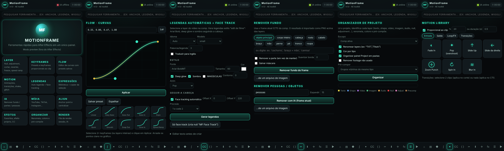

# MotionFrame — extensão para After Effects

Painel CEP (After Effects 2020+) que junta, num só lugar, ferramentas de mobilidade, animação e IA.



## Funções

| Aba | O que faz |
|---|---|
| **Layer** | Null, adjustment, solid, câmera, texto, pre-compor, cortar no CTI, trim início/fim, reverter clip, freeze frame, sequenciar layers, motion blur, texto → palavras, comp a partir do footage, **speed ramp** (estilo twixtor, com Timewarp opcional), presets de comp (9:16, 16:9, 1:1, 4K...) |
| **Keyframes proporcionais** | Encaixa os keyframes no tamanho do clip: *esticar tudo*, *intro no início/outro no fim* ou *ocupar X% do clip*. Lista uma pasta de presets `.ffx`: ao aplicar, só os keyframes que o preset criou são reescalados para o clip. |
| **Flow** | Editor de curva bezier (arrastar os pontos), presets prontos + presets salvos (clique direito apaga), espelhar, **ler** a curva dos keyframes selecionados e aplicar como temporal ease. |
| **Motion Library** | Presets procedurais (sem precisar de arquivos): entradas, saídas, shake, bounce/inércia, glitch, flash, deep glow e **transições** (zoom, slide, whip pan, spin, flash, blur) feitas com adjustment layer + Transform + Motion Tile. Opção proporcional ao clip. |
| **Legendas + Face Track** | Transcreve o áudio com Whisper (timestamps por palavra, vários idiomas, tradução para inglês), cria uma layer de texto por legenda em **Arial Bold, deep glow (usa o plugin Deep Glow se instalado; senão simula com 2 Glows) e drop shadow**, e faz **face tracking automático**: cria o null `MF Face Track` com sliders de Offset X/Y e Smooth, e as legendas seguem a cabeça. Dá para editar o texto antes de criar. |
| **Expressões** | Biblioteca com ~30 expressões mais usadas (wiggle, loopOut, inércia, bounce, typewriter, contador, decode, fade automático, caixa que acompanha o texto...). **Copiar expressões da seleção** salva automaticamente as expressões das layers/props selecionadas (e manda para o clipboard). Editor + "Minhas". |
| **IA** | **Remover fundo** do frame atual: objeto principal, corpo inteiro, cabeça, rosto, cabelo, braço, mão, perna, pé, tronco, roupa — ou **digite o que quer** (`cachorro`, `braço + mão`...). Pode manter ou remover a parte. **Remover pessoas/objetos** com inpainting (LaMa; OpenCV como reserva). O resultado é importado como PNG no CTI. |
| **Mídia** | Baixa de YouTube, TikTok, Instagram, X, Vimeo e +1000 sites (yt-dlp) em MP4 H.264 (importa liso no AE), MP3 ou WAV; também **pesquisa** vídeos por nome. Importa direto na comp. |
| **Align** | Grade 3×3 de **anchor point** (move a âncora sem deslocar a layer, compensando escala/rotação), alinhar/centralizar na comp, fit/fill/largura/altura. |
| **Efeitos** | Efeitos favoritos com 1 clique, **efeito próprio** (salva a pilha de efeitos de uma layer — valores, keyframes e expressões — e reaplica em outras, com keyframes proporcionais), presets de cor (teal & orange, P&B, quente, frio, vibrante, faded, vinheta). |
| **Organizar** | Lê a comp ativa ou todas, identifica cada layer (texto, shape, vídeo, imagem, sequência, áudio, null, adjustment, solid, precomp, câmera, luz), **renomeia** (`TXT \| Título`, `VIDEO \| clip01`, `SHP \| Circulo`...), **colore por tipo**, **pré-compõe** grupos e organiza o painel Project em pastas. |
| **Render / Sessão** | Fila de render (H.264, ProRes, PNG), tempo de uso (hoje/mês/ano), status do servidor de IA. |
| **Busca** | Campo no topo encontra qualquer ferramenta (Enter abre). |

## Instalação

1. **Windows:** execute `tools/install_windows.bat` · **macOS:** `bash tools/install_mac.sh`
   (habilita extensões não assinadas — `PlayerDebugMode` — e copia a pasta para `CEP/extensions/MotionFrame`).
2. Reabra o After Effects → **Window › Extensions › MotionFrame**.
3. Para as funções de IA instale **Python 3.10–3.12** e as dependências:
   `pip install -r server/requirements.txt`
   O painel inicia o servidor sozinho (ou rode `tools/start_server.*`). Na aba **Render** você vê quais recursos estão disponíveis e pode definir o caminho do Python.

Sem Python, todas as ferramentas que não são de IA (keyframes, flow, motion, expressões, align, efeitos, organizador, render) funcionam normalmente.

Na primeira vez, os modelos (Whisper, rembg, CLIPSeg, LaMa) são baixados automaticamente. Arquivos gerados ficam em `~/MotionFrame`.

## Estrutura

```
CSXS/manifest.xml       manifesto CEP (AEFT 17+)
client/                 painel (HTML/CSS/JS)
  js/cep.js             ponte com o ExtendScript
  js/data.js            bibliotecas: expressões, presets, curvas, efeitos
  js/main.js            lógica das abas
jsx/hostscript.jsx      todas as ações dentro do After Effects (funções mf_*)
server/mf_server.py     servidor local de IA em 127.0.0.1:5717
tools/                  instaladores e scripts de inicialização
```

## Observações

- Alguns parâmetros de efeitos são definidos pelo nome em inglês; no AE em outro idioma esses valores podem ficar no padrão (o efeito é adicionado mesmo assim).
- Para usar o Deep Glow "de verdade" instale o plugin Deep Glow; senão o MotionFrame cria um glow duplo equivalente.
- Baixe apenas mídias que você tem direito de usar.
- O painel é inspirado nos fluxos mostrados nos vídeos de referência, mas a interface, os presets e o código são originais — não copiam o Motion Bro, o Flow nem outras extensões comerciais.
